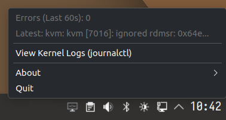

# dmesg-watch

A lightweight Linux system tray applet that monitors kernel errors in real time.

Zero GUI platform bloat, ~15MB memory footprint, intelligent burst flood dampening, and one-click drill-down into your terminal logs.

<p align="center">
  
</p>

## Highlights

* 🪶 **Featherweight**: Pure Go static binary. No Qt, GTK, or Electron platform baggage. Communicates directly over D-Bus and idles at ~15MB RSS.
* 🔇 **Smart Flood Protection**: Ignores isolated transient blips. Only notifies when error frequency crosses your threshold, with an automatic cooldown to prevent notification spam.
* ⚡ **Instant Drill-Down**: Click the tray icon to see error counts and the latest kernel message, or jump directly into live streaming logs inside your default terminal (Ghostty, Konsole, GNOME Terminal, etc.).
* 🔌 **Dual Streaming Engines**: Streams from `journalctl` by default, with automatic fallback or direct selection (`-backend=dmesg`) on non-systemd desktop distributions (Alpine, Void, Artix).
* 🖥️ **Universal Desktop Support**: Native StatusNotifierItem (SNI) tray integration for KDE Plasma, GNOME, Sway, Waybar, and Hyprland.

## Quick Start

### 1. Distro Packages (.deb / .rpm)
Download the [latest release](https://github.com/comicdeed/dmesg-watch/releases/latest) (or preview upcoming builds via [pre-releases](https://github.com/comicdeed/dmesg-watch/releases)). Installing the package automatically sets up and starts the background user service.

### 2. Nix / NixOS
```bash
nix run github:codemedic/dmesg-watch
```

### 3. From Source
```bash
git clone https://github.com/comicdeed/dmesg-watch.git && cd dmesg-watch && make install
```

---

📖 **User Guide**: For YAML configuration (`config.yaml`), command-line flags, permission setup, and terminal customization, see the **[User Guide](docs/user-guide.md)**.

## License

MIT License.
