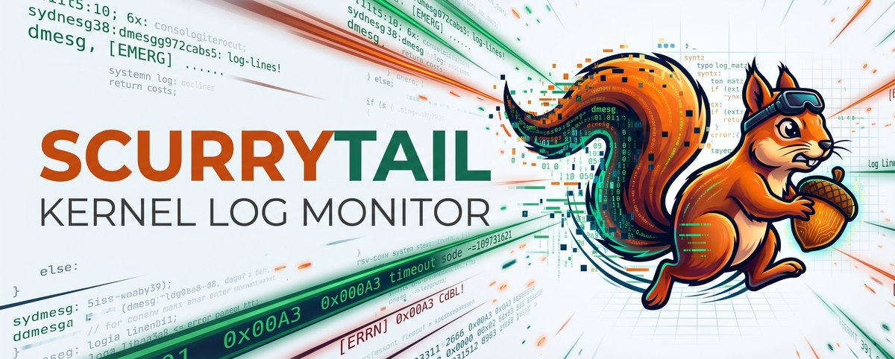

# ScurryTail

A nimble Linux system tray applet for tailing fast-moving kernel logs and catching errors in real time.

Zero GUI platform bloat, ~15MB memory footprint, intelligent burst flood dampening, and instant terminal drill-down to chase the tail of your live logs.

<p align="center">
  <picture>
    <source media="(prefers-color-scheme: dark)" srcset="docs/assets/scurrytail-dark.jpg">
    <source media="(prefers-color-scheme: light)" srcset="docs/assets/scurrytail-light.jpg">
    
  </picture>
</p>

## Highlights

* 🪶 **Featherweight**: Pure Go static binary. No Qt, GTK, or Electron platform baggage. Communicates directly over D-Bus and idles at ~15MB RSS.
* 🐿️ **Chase the Tail**: Click the tray icon to inspect error counts, or jump instantly into live streaming logs inside your default terminal (Ghostty, Konsole, GNOME Terminal, etc.).
* 🔇 **Smart Flood & Category Protection**: Classify subsystem errors with custom thresholds, silence benign kernel noise, and prevent alert fatigue via rate dampening.
* 🔌 **Dual Streaming Engines**: Streams from `journalctl` by default, with automatic fallback or direct selection (`--backend=dmesg`) on non-systemd desktop distributions (Alpine, Void, Artix).
* 🖥️ **Universal Desktop Support**: Native StatusNotifierItem (SNI) tray integration for KDE Plasma, GNOME, Sway, Waybar, and Hyprland.

## Quick Start

### 1. Distro Packages (.deb / .rpm)
Download the [latest release](https://github.com/comicdeed/scurrytail/releases/latest) (or preview upcoming builds via [pre-releases](https://github.com/comicdeed/scurrytail/releases)). Installing the package automatically sets up and starts the background user service.

### 2. Nix / NixOS
```bash
nix run github:comicdeed/scurrytail
```

### 3. From Source
```bash
git clone https://github.com/comicdeed/scurrytail.git && cd scurrytail && make install
```

---

📖 **User Guide**: For YAML configuration (`config.yaml`), command-line flags, permission setup, and terminal customization, see the **[User Guide](docs/user-guide.md)**.

## License

MIT License.
