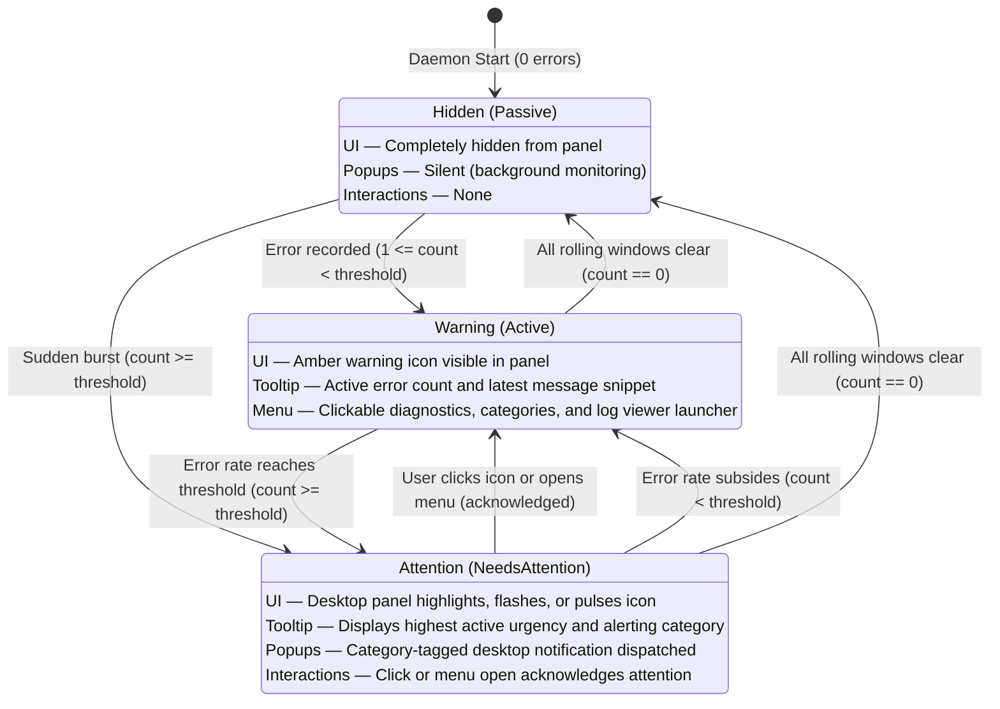

# User Guide

`ScurryTail` is a nimble Linux desktop tray application that monitors kernel errors in real time. It sits in your system tray, maintains a rolling count of recent faults, and notifies you only when an error burst crosses your threshold so you can chase the tail of your logs.

---

## 🖥️ System Tray States

`ScurryTail` stays invisible until something needs your attention:

| State | Status | Panel / Tray UI | Desktop Popups | Interactions |
| :--- | :--- | :--- | :--- | :--- |
| **Hidden (Default)** | Passive | Icon is completely hidden (no panel space used) | Silent; daemon listens in background | None (item is invisible) |
| **Visible (Warning)** | Active | Amber warning icon emerges in panel | Silent if error rate is below threshold | Hover tooltip shows active error count; menu provides diagnostics and log viewer |
| **Attention** | NeedsAttention | Desktop panel highlights, flashes, or pulses the icon | Desktop notification dispatched | Click or menu open acknowledges and clears attention back to Active |

Hovering over the tray icon reveals a **dynamic priority tooltip**:
* **Alerting**: `ScurryTail: CRITICAL [storage] (1 error in 5m)`
* **Active**: `ScurryTail: ACTIVE (3 active errors in rolling window)`
* **Passive**: `ScurryTail: Nimble kernel log watcher & error monitor`

The icon automatically disappears once all rolling windows clear with no active errors.

### How the Icon Behaves



---

## 📋 The Tray Menu

Click the tray icon to view quick diagnostics:

```text
Errors (Recent): 4
Latest: EXT4-fs (sda1): I/O error while writing superblock
Categories                                             ▶
  ├─ storage: 1
  └─ wifi: 3
────────────────────────────────────────────────────────
View Kernel Logs (journalctl)
────────────────────────────────────────────────────────
About                                                  ▶
  ├─ ScurryTail v0.3.0
  ├─ ──────────────────────────────────────────────────
  └─ Website
Quit
```

* **Errors (Recent)**: Total active kernel errors across all configured categories and unclassified errors.
* **Latest**: The message snippet of the most recent error.
  > [!TIP]
  > **Priority Latching**: If a high-priority alert (such as `critical` storage degradation) is actively alerting, lower-urgency background events (such as USB or Wi-Fi blips) **cannot overwrite** the critical error message in `Latest`.
* **Categories**: Dynamically displays counts for active categories. Automatically hidden when no category errors are present.
* **View Kernel Logs**: Opens your default terminal (Ghostty, Konsole, GNOME Terminal, etc.) streaming live kernel logs with the last 50 lines displayed.
* **About $\rightarrow$ Website**: Opens the project repository in your default browser.
* **Quit**: Exits the monitor.

---

## 🔔 Desktop Notifications

`ScurryTail` avoids desktop spam while ensuring critical hardware alerts are never missed:
* **Silent by Default**: Stays silent during occasional, isolated errors below threshold.
* **Category-Tagged Alerts**: Identifies which subsystem breached its threshold:
  * `⚠️ High Kernel Error Rate [storage]`
  * `Detected 1 storage errors in the last 5m0s! Latest: EXT4-fs (sda1): I/O error...`
* **Configurable Urgency**:
  * **`critical`** (`storage`, `gpu`): Emitted with D-Bus urgency `2` and persistent expiration (remains visible on screen until dismissed by the user).
  * **`normal`** (`usb`, unclassified): Standard desktop notification (8 seconds).
  * **`low`** (`dock`, `wifi`): Non-intrusive transient notification (5 seconds).
* **Burst Cooldown**: Per-category cooldowns suppress follow-up popups during sustained error bursts while the tray menu continues updating in real time.

---

## ⚙️ Configuration File (`config.yaml`)

When running as a background service, using a configuration file avoids needing to edit systemd unit files.

Create **`~/.config/scurrytail/config.yaml`**:

```yaml
# ScurryTail configuration

# Kernel streaming backend: auto | journalctl | dmesg
backend: auto

# Global alert threshold (errors per window required for notification)
threshold: 5

# Global rolling evaluation time window
window: 60s

# Global minimum cooldown between alert popups
cooldown: 45s

# Custom command to open when clicking "View Kernel Logs" (one-line array format)
# If empty, automatically matches active backend (journalctl or dmesg)
viewer_cmd: ["ghostty", "-e", "journalctl", "-k", "-f", "-n", "50"]

# Benign errors to completely suppress (no tray count, no alerts)
ignore:
  - "ACPI:.*Method _OSI failed"
  - "thermal thermal_zone.*failed to read out thermal zone"

# Subsystem error categories
# Classified errors count towards their category and do NOT increment the global count
categories:
  disk:
    threshold: 1          # Alert immediately on storage degradation
    window: 5m
    cooldown: 1m
    urgency: critical     # Persists on desktop until dismissed
    patterns:
      - "EXT4-fs error"
      - "BTRFS: error"
      - "blk_update_request: I/O error"
      - "nvme.*status: 0x"

  wifi:
    threshold: 8          # Tolerant to frequent roaming re-auths
    window: 2m
    cooldown: 3m
    urgency: low
    patterns:
      - "iwlwifi.*"
      - "ath10k.*"
```

Configuration values are loaded in hierarchical order:
$$\text{Built-in Defaults} \longrightarrow \text{System Config} \longrightarrow \text{System conf.d/} \longrightarrow \text{User Config} \longrightarrow \text{User conf.d/} \longrightarrow \text{Environment Variables} \longrightarrow \text{CLI Flags}$$

> [!NOTE]
> For smooth upgrades, `ScurryTail` also checks legacy `~/.config/dmesg-watch/` if `~/.config/scurrytail/` is not present.

---

## 🧩 Modular Configuration & Drop-ins (`conf.d/`)

ScurryTail supports modular drop-in YAML files in `conf.d/` directories:
* **System-wide drop-ins**: `/etc/scurrytail/conf.d/*.yaml`
* **Per-user drop-ins**: `~/.config/scurrytail/conf.d/*.yaml`

Files within `conf.d/` load in alphabetical order (e.g. `00-silence.yaml`, `10-storage.yaml`, `20-gpu.yaml`). Configuration layers merge automatically:
- Scalar options (`threshold`, `window`, `backend`) override previous layers if explicitly defined.
- `ignore` patterns append across layers.
- Categories merge by name (properties override; patterns append and deduplicate).

### 1. NixOS & Home Manager Multi-Host Setup
Maintain a common baseline across all your flake machines while declaring host-specific hardware drop-ins on particular machines:

**Common Baseline (`modules/home/scurrytail.nix`):**
```nix
xdg.configFile."scurrytail/config.yaml".text = ''
  threshold: 5
  window: 60s
  cooldown: 45s
  ignore:
    - "ACPI:.*Method _OSI failed"
'';
```

**Laptop Flake Host (`hosts/laptop/default.nix`):**
```nix
# Wi-Fi driver tolerance for mobile hardware
xdg.configFile."scurrytail/conf.d/10-laptop.yaml".text = ''
  categories:
    wifi:
      threshold: 8
      window: 2m
      patterns:
        - "iwlwifi.*"
'';
```

**Workstation Flake Host (`hosts/workstation/default.nix`):**
```nix
# GPU crash and driver reset monitoring
xdg.configFile."scurrytail/conf.d/20-gpu.yaml".text = ''
  categories:
    gpu:
      threshold: 1
      urgency: critical
      patterns:
        - "NVRM: GPU at.*has fallen off the bus"
        - "Xid \\(PCI:.*\\):"
        - "amdgpu.*ring.*timeout"
'';
```

---

### 2. Desktop Hardware Recipes

#### Storage Integrity (`~/.config/scurrytail/conf.d/10-storage.yaml`)
Trigger instant critical desktop alerts on drive faults:
```yaml
categories:
  disk:
    threshold: 1
    window: 5m
    cooldown: 1m
    urgency: critical
    patterns:
      - "EXT4-fs error"
      - "BTRFS: error"
      - "blk_update_request: I/O error"
      - "nvme.*status: 0x"
      - "zfs: checksum"
```

#### Silence Benign Noise (`~/.config/scurrytail/conf.d/00-silence.yaml`)
Completely suppress known harmless BIOS or hardware chatter:
```yaml
ignore:
  - "ACPI:.*Method _OSI failed"
  - "Bluetooth: hci0: Malformed frame"
  - "thermal thermal_zone.*failed to read out thermal zone"
```

#### Ad-Hoc Driver Troubleshooting (`~/.config/scurrytail/conf.d/99-debug.yaml`)
Temporarily monitor a flaky USB or PCIe peripheral during development:
```yaml
categories:
  debug_usb:
    threshold: 1
    patterns:
      - "usb 1-1:.*"
```
*(Delete or rename to `.yaml.disabled` once troubleshooting is complete).*

---

## 💻 Command-Line Flags & Environment Variables

All settings can be configured via YAML configuration file, environment variables, or CLI flags:

| Flag | Environment Variable | Default | Description |
| :--- | :--- | :--- | :--- |
| `-c`, `--config` | `SCURRYTAIL_CONFIG` | *(auto)* | Path to custom YAML configuration file. |
| `--backend` | `SCURRYTAIL_BACKEND` | `auto` | Kernel streaming backend: `auto`, `journalctl`, or `dmesg`. |
| `--threshold` | `SCURRYTAIL_THRESHOLD` | `5` | Number of errors within the window required to trigger a notification. |
| `--window` | `SCURRYTAIL_WINDOW` | `1m` | Rolling evaluation window duration (`30s`, `1m`, `2m`). |
| `--cooldown` | `SCURRYTAIL_COOLDOWN` | `45s` | Minimum wait time between desktop notifications during sustained errors. |
| `--viewer-cmd` | `SCURRYTAIL_VIEWER_CMD` | *(auto)* | Custom command to run when clicking "View Kernel Logs". |
| `-h`, `--help` | — | — | Displays the help message with options and environment variables. |
| `-v`, `--version` | — | — | Prints the application version and exits. |

### Examples

**Lower the alert threshold for sensitive hardware testing:**
```bash
scurrytail -threshold=2 -window=30s
```

**Use dmesg backend on non-systemd systems:**
```bash
scurrytail -backend=dmesg
```

**Open logs using your favorite terminal or GUI viewer:**
```bash
scurrytail -viewer-cmd="ghostty -e journalctl -k -f"
```

---

## 🔒 Permissions

To read kernel logs without root privilege:

### 1. `journalctl` Backend (Default)
Add your user account to the journal groups:
```bash
sudo usermod -aG systemd-journal,adm $USER
```
*(Log out and log back in for group changes to take effect).*

### 2. `dmesg` Backend
Many Linux distributions restrict unprivileged `dmesg` access (`kernel.dmesg_restrict = 1`). To allow unprivileged monitoring:
* Allow access globally:
  ```bash
  sudo sysctl -w kernel.dmesg_restrict=0
  ```
* Or grant the `CAP_SYSLOG` capability to the binary:
  ```bash
  sudo setcap cap_syslog=ep $(which scurrytail)
  ```

---

## 🛠️ Service Management

When installed from packages (`.deb`, `.rpm`) or `make install`, `scurrytail` runs automatically as a systemd user service.

**Check service status:**
```bash
systemctl --user status scurrytail.service
```

**Stop the service:**
```bash
systemctl --user stop scurrytail.service
```

**Disable automatic startup:**
```bash
systemctl --user disable scurrytail.service
```

**Enable automatic startup:**
```bash
systemctl --user enable --now scurrytail.service
```

---

## ❄️ Nix & NixOS

### 1. Run Ad-Hoc
```bash
nix run github:comicdeed/scurrytail
```

### 2. Home Manager (Per-User)
Add the input to `flake.nix`:
```nix
inputs.scurrytail.url = "github:comicdeed/scurrytail";
```

Import and enable in Home Manager:
```nix
{ inputs, ... }: {
  imports = [ inputs.scurrytail.homeManagerModules.default ];

  services.scurrytail = {
    enable = true;
    backend = "journalctl";
    threshold = 5;
    window = "1m";
    cooldown = "45s";
    viewerCmd = [ "ghostty" "-e" "journalctl" "-k" "-f" "-n" "50" ];
  };
}
```

### 3. NixOS System Configuration (System-Wide)
Add the module in `/etc/nixos/configuration.nix`:
```nix
{ inputs, ... }: {
  imports = [ inputs.scurrytail.nixosModules.default ];

  services.scurrytail = {
    enable = true;
    backend = "auto";
    threshold = 5;
  };
}
```
This installs `scurrytail` system-wide and automatically starts the service for any desktop session (`graphical-session.target`).
