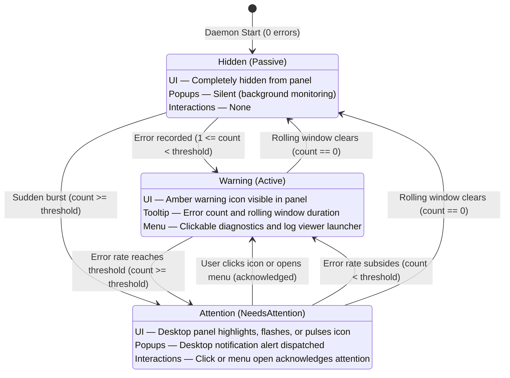
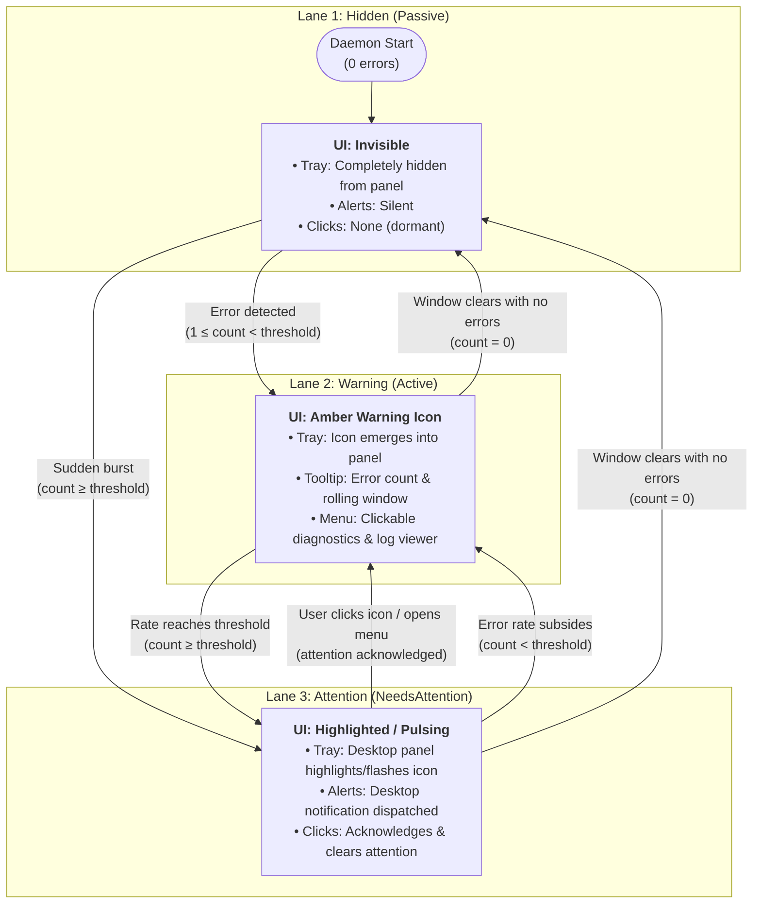
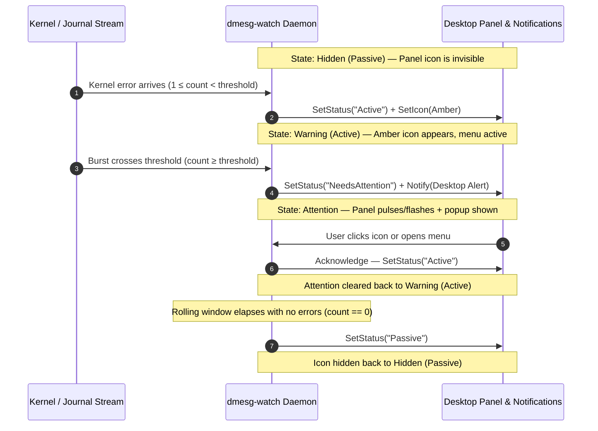

# User Guide

`dmesg-watch` is a quiet Linux desktop tray application that monitors kernel errors in real time. It sits in your system tray, maintains a rolling count of recent faults, and notifies you only when an error burst crosses your threshold.

---

## 🖥️ System Tray States

`dmesg-watch` stays invisible until something needs your attention:

| State | Status | Panel / Tray UI | Desktop Popups | Interactions |
| :--- | :--- | :--- | :--- | :--- |
| **Hidden (Default)** | Passive | Icon is completely hidden (no panel space used) | Silent; daemon listens in background | None (item is invisible) |
| **Visible (Warning)** | Active | Amber warning icon emerges in panel | Silent if error rate is below threshold | Hover tooltip shows error count; menu provides diagnostics and log viewer |
| **Attention** | NeedsAttention | Desktop panel highlights, flashes, or pulses the icon | Desktop notification dispatched | Click or menu open acknowledges and clears attention back to Active |

The icon automatically disappears once the rolling window clears with no new errors.

### State Transition Diagrams

#### 1. UML State Machine (`stateDiagram-v2`)



#### 2. 3-Lane Flowchart (`flowchart TD`)



#### 3. Sequence Lifelines (`sequenceDiagram`)



---

## 📋 The Tray Menu

Click the tray icon to view quick diagnostics:

```text
Errors (Last 60s): 3
Latest: usb 1-1: device descriptor read/64, error -110
────────────────────────────────────────────────────────
View Kernel Logs (journalctl)
────────────────────────────────────────────────────────
About                                                  ▶
  ├─ dmesg-watch v0.3.0
  ├─ Real-time kernel error monitor
  ├─ ──────────────────────────────────────────────────
  └─ Website
Quit
```

* **Errors (Last 60s)**: Total number of kernel errors recorded in the sliding window.
* **Latest**: The message snippet of the most recent error.
* **View Kernel Logs**: Opens your default terminal (Ghostty, Konsole, GNOME Terminal, etc.) streaming live kernel logs with the last 50 lines displayed.
* **About $\rightarrow$ Website**: Opens the project repository in your default browser.
* **Quit**: Exits the monitor.

---

## 🔔 Desktop Notifications

`dmesg-watch` avoids desktop spam:
* It stays silent during occasional, isolated errors.
* It sends a notification popup only when error frequency exceeds your threshold (default: 5 errors in 60 seconds).
* An automatic 45-second cooldown suppresses follow-up popups during error bursts while the tray menu continues updating in real time.

---

## ⚙️ Configuration File (`config.yaml`)

When running as a background service, using a configuration file avoids needing to edit systemd unit files.

Create **`~/.config/dmesg-watch/config.yaml`**:

```yaml
# dmesg-watch configuration

# Kernel streaming backend: auto | journalctl | dmesg
backend: auto

# Number of errors in the rolling window required to trigger a notification
threshold: 5

# Rolling evaluation time window
window: 60s

# Minimum cooldown between alert popups
cooldown: 45s

# Custom command to open when clicking "View Kernel Logs" (one-line array format)
# If empty, automatically matches active backend (journalctl or dmesg)
viewer_cmd: ["ghostty", "-e", "journalctl", "-k", "-f", "-n", "50"]
```

Configuration values are loaded in order:
$$\text{Built-in Defaults} \longrightarrow \text{Config File} \longrightarrow \text{Environment Variables} \longrightarrow \text{Command Line Flags}$$

---

## 💻 Command-Line Flags & Environment Variables

All settings can be configured via YAML configuration file, environment variables, or CLI flags:

| Flag | Environment Variable | Default | Description |
| :--- | :--- | :--- | :--- |
| `-c`, `--config` | `DMESG_WATCH_CONFIG` | *(auto)* | Path to custom YAML configuration file. |
| `--backend` | `DMESG_WATCH_BACKEND` | `auto` | Kernel streaming backend: `auto`, `journalctl`, or `dmesg`. |
| `--threshold` | `DMESG_WATCH_THRESHOLD` | `5` | Number of errors within the window required to trigger a notification. |
| `--window` | `DMESG_WATCH_WINDOW` | `1m` | Rolling evaluation window duration (`30s`, `1m`, `2m`). |
| `--cooldown` | `DMESG_WATCH_COOLDOWN` | `45s` | Minimum wait time between desktop notifications during sustained errors. |
| `--viewer-cmd` | `DMESG_WATCH_VIEWER_CMD` | *(auto)* | Custom command to run when clicking "View Kernel Logs". |
| `-h`, `--help` | — | — | Displays the help message with options and environment variables. |
| `-v`, `--version` | — | — | Prints the application version and exits. |

### Examples

**Lower the alert threshold for sensitive hardware testing:**
```bash
dmesg-watch -threshold=2 -window=30s
```

**Use dmesg backend on non-systemd systems:**
```bash
dmesg-watch -backend=dmesg
```

**Open logs using your favorite terminal or GUI viewer:**
```bash
dmesg-watch -viewer-cmd="ghostty -e journalctl -k -f"
```

---

## 🔒 Permissions

To read kernel logs without root privilege:

### 1. `journalctl` Backend (Default)
Add your user account to the journal groups:
```bash
sudo usermod -aG systemd-journal,adm $USER
```
*(Log out and log back in for group changes to take effect).*

### 2. `dmesg` Backend
Many Linux distributions restrict unprivileged `dmesg` access (`kernel.dmesg_restrict = 1`). To allow unprivileged monitoring:
* Allow access globally:
  ```bash
  sudo sysctl -w kernel.dmesg_restrict=0
  ```
* Or grant the `CAP_SYSLOG` capability to the binary:
  ```bash
  sudo setcap cap_syslog=ep $(which dmesg-watch)
  ```

---

## 🛠️ Service Management

When installed from packages (`.deb`, `.rpm`) or `make install`, `dmesg-watch` runs automatically as a systemd user service.

**Check service status:**
```bash
systemctl --user status dmesg-watch.service
```

**Stop the service:**
```bash
systemctl --user stop dmesg-watch.service
```

**Disable automatic startup:**
```bash
systemctl --user disable dmesg-watch.service
```

**Enable automatic startup:**
```bash
systemctl --user enable --now dmesg-watch.service
```

---

## ❄️ Nix & NixOS

### 1. Run Ad-Hoc
```bash
nix run github:codemedic/dmesg-watch
```

### 2. Home Manager (Per-User)
Add the input to `flake.nix`:
```nix
inputs.dmesg-watch.url = "github:codemedic/dmesg-watch";
```

Import and enable in Home Manager:
```nix
{ inputs, ... }: {
  imports = [ inputs.dmesg-watch.homeManagerModules.default ];

  services.dmesg-watch = {
    enable = true;
    backend = "journalctl";
    threshold = 5;
    window = "1m";
    cooldown = "45s";
    viewerCmd = [ "ghostty" "-e" "journalctl" "-k" "-f" "-n" "50" ];
  };
}
```

### 3. NixOS System Configuration (System-Wide)
Add the module in `/etc/nixos/configuration.nix`:
```nix
{ inputs, ... }: {
  imports = [ inputs.dmesg-watch.nixosModules.default ];

  services.dmesg-watch = {
    enable = true;
    backend = "auto";
    threshold = 5;
  };
}
```
This installs `dmesg-watch` system-wide and automatically starts the service for any desktop session (`graphical-session.target`).

